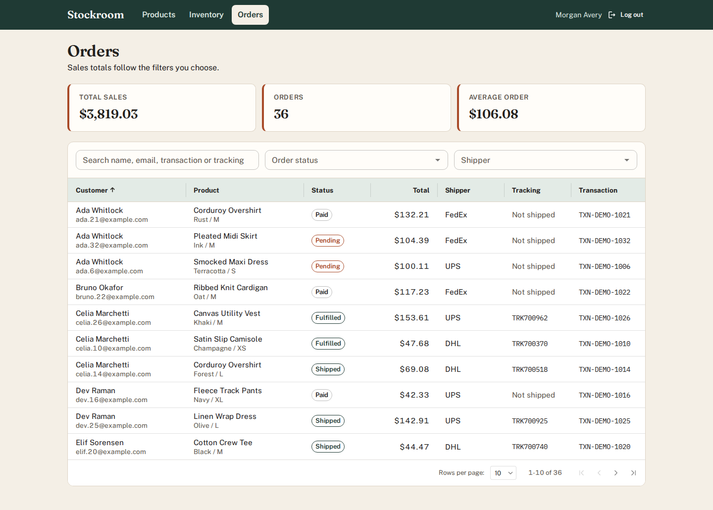
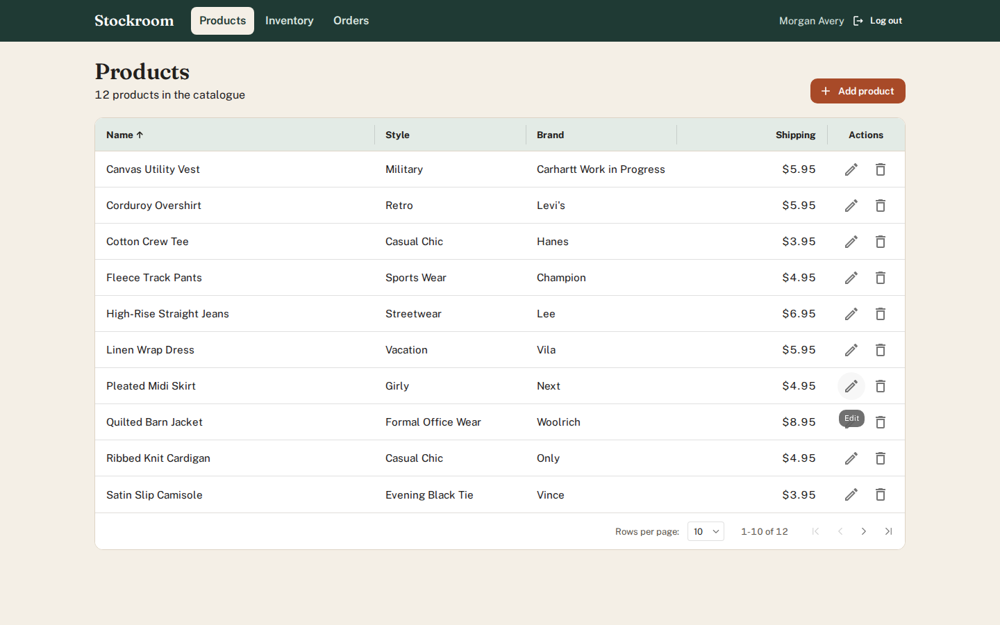
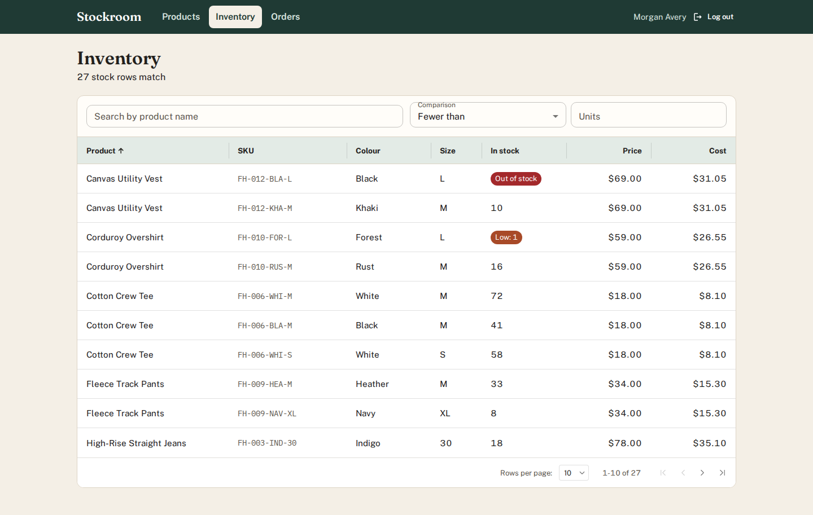
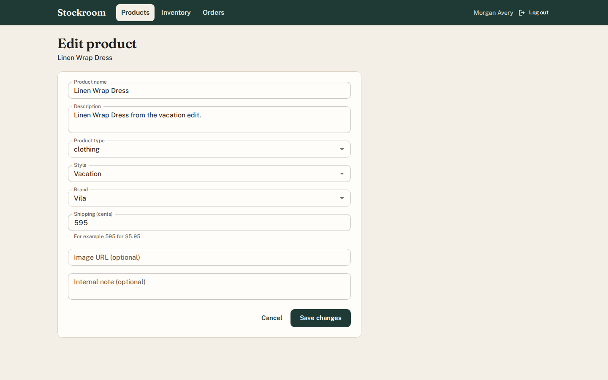
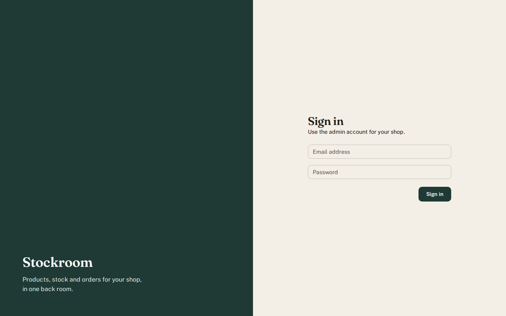
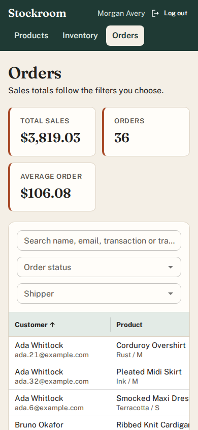
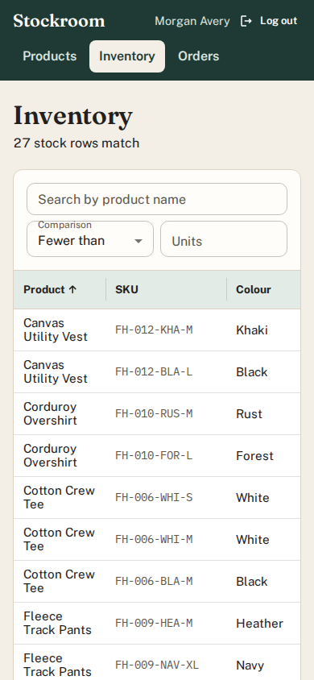
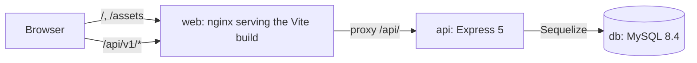
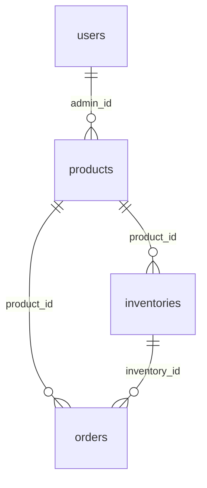

# Stockroom

Stockroom is a back-office admin for a small clothing shop. Staff sign in to
keep the product catalogue up to date, see which sizes and colours are running
low, and follow orders from payment to shipping with sales totals that match
whatever filter is applied.

It is two applications in one repository:

- `commonSold-backend/`: a JSON API built with Express 5, Sequelize and MySQL.
- `commentSold-frontend/`: a React 19 admin built with Vite and MUI.



## What it does

- **Products**: list, sort, add, edit and delete products. Style, brand and
  product type come from lists the API serves, so the catalogue stays
  consistent. Only the admin who created a product (or a superadmin) can change
  it, and a product that has been ordered cannot be deleted.
- **Inventory**: every stock row (one per colour and size) with SKU, price and
  cost. Search by product name, or filter by stock level ("fewer than 5 units").
  Empty and low rows are flagged.
- **Orders**: search by customer, email, transaction or tracking number, and
  filter by status and shipper. Total sales, order count and average order
  value are recalculated for the same filter. Each order shows the exact
  variant that was bought.

| Products | Inventory | Edit a product |
| --- | --- | --- |
|  |  |  |

On a phone the navigation moves under the header, filters stack, and tables
scroll inside their own panel:

| Sign in | Orders | Inventory |
| --- | --- | --- |
|  |  |  |

## Quick start

You need Docker with Compose. From the repository root:

```bash
docker compose up --build
```

Then open <http://localhost:8080> and sign in with the demo account:

- Email: `demo@example.com`
- Password: `Stockroom1`

A second admin, `riley@example.com` (same password), owns a few products, so
you can see the ownership rule at work. On first start the API creates the
tables and loads a fictional shop: 12 products, 27 stock rows and 36 orders.
Every name and address in it is made up. Later starts keep your data. Run
`docker compose down -v` to start over.

The API is also published on <http://localhost:5000>, for example for the
requests in [docs/api-examples.md](docs/api-examples.md).

| Variable | Default | Used for |
| --- | --- | --- |
| `DB_PASSWORD` | `stockroom-local` | MySQL user password, shared by `db` and `api` |
| `JWT_SECRET` | `local-only-change-me` | Signing session tokens; set your own outside local use |

## How it fits together



nginx serves the admin and proxies `/api/` to the API, so the browser only ever
talks to one origin. The data model is four tables:



## API

All routes live under `/api/v1/`. Everything except login needs the token in an
`access-token` header; a missing, expired or forged token gets `401`.

| Method and path | Purpose |
| --- | --- |
| `POST auth/login` | `{ email, password }` returns `{ token }` |
| `GET products` | Paged product list |
| `GET products/:id` | One product (`404` if missing) |
| `POST products` | Create (`201`) |
| `PUT products/:id` | Update; owner or superadmin only (`403` otherwise) |
| `DELETE products/:id` | Delete with its stock rows; `409` if it has orders |
| `GET products/styles`, `products/brands`, `products/types` | Allowed values for the product form |
| `GET inventories` | Stock rows; filters `name`, `quantity` + `operator` (`lt`, `gt`, `eq`) |
| `GET orders` | Orders plus `totalSale`, `average` and `count` for the same filters `name`, `order_status`, `shipper` |

List endpoints take `page` (from 0), `limit` (1-100), and optionally
`sort_table_name`, `sort_column` and `sort_order` (`asc`/`desc`). Money is
always in integer cents. See [docs/api-examples.md](docs/api-examples.md) for
real requests and responses.

## Design notes

- **Passwords are bcrypt hashes.** Login looks the user up by email and
  compares against `password_hash`. A wrong password and an unknown email get
  the same `401`.
- **Sorting is whitelisted.** Sort parameters come from the query string, so
  each endpoint lists the columns it allows, and anything else is a `400`
  rather than reaching `ORDER BY`.
- **Totals follow the filter.** The orders endpoint runs the page query, the
  count and the sum with the same `WHERE`. The average is the filtered total
  divided by the filtered count.
- **Orders point at a variant.** An order links to the inventory row it was
  placed for, so the admin shows "Sand / M" rather than every colour of the
  product.
- **The admin never swallows errors.** API helpers throw, and each page shows
  skeleton rows while loading, an empty message, or the API's own error with a
  retry button. Any `401` signs the admin out.
- **Seeding is idempotent.** `npm run seed` only loads data into an empty
  database, which is why the Compose service can run it on every start.

## Developing without Docker

You need Node 22 (see `.nvmrc`) and a MySQL 8 database.

```bash
cd commonSold-backend
cp .env.example .env      # point DB_* at your database and set JWT_SECRET
npm install
npm run seed              # create tables and load the demo shop
npm run dev               # API on http://localhost:5000, restarts on change

cd ../commentSold-frontend
cp .env.example .env      # VITE_API_BASE_URL=http://localhost:5000/api/v1/
npm install
npm run dev               # admin on http://localhost:3000
```

## Tests and checks

```bash
cd commonSold-backend
npm run lint
npm test                  # paging, filters, sort whitelist, auth guard, validation
TEST_DATABASE=1 npm test  # also runs the MySQL suite (or: npm run test:db)

cd ../commentSold-frontend
npm run lint
npm test -- --run         # components and pages against mocked API modules
npm run build
```

The MySQL suite (`tests/db`) drops and recreates every table, so point the
`DB_*` settings at a throwaway database before running it. It covers login,
filtered order totals, the ordered variant, joined sorting, the stock threshold,
product create/read/update/delete, the ownership rule and the `409` on deleting
an ordered product.

## Limitations

- There is no sign-up or password reset; admins are created by the seed or
  directly in the database.
- Orders and inventory are read-only in the admin. Stock levels are not
  decremented by orders.
- Schema changes go through `sequelize.sync()`, which creates missing tables
  but never alters existing ones. A real deployment would need migrations.
- Tokens are kept in `localStorage`, which is simple but readable by any script
  on the page.

## License

MIT, see [LICENSE](LICENSE).
